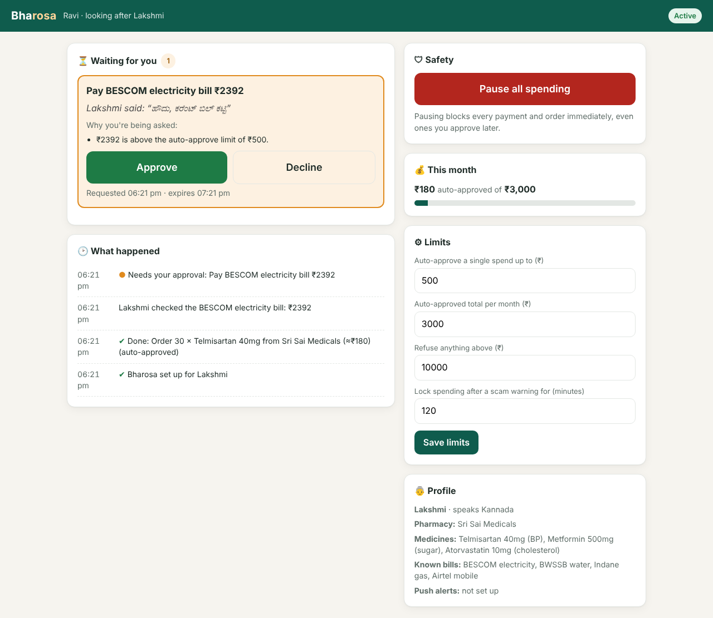
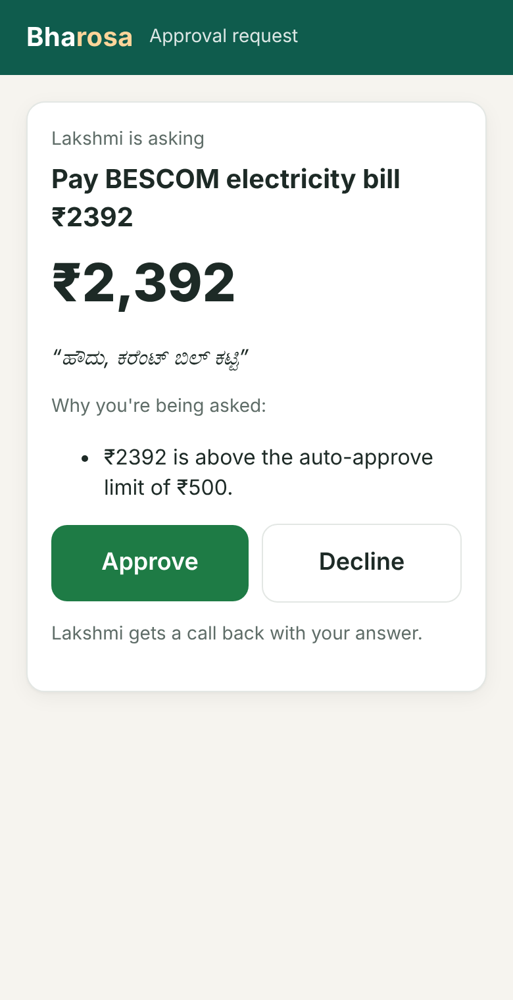
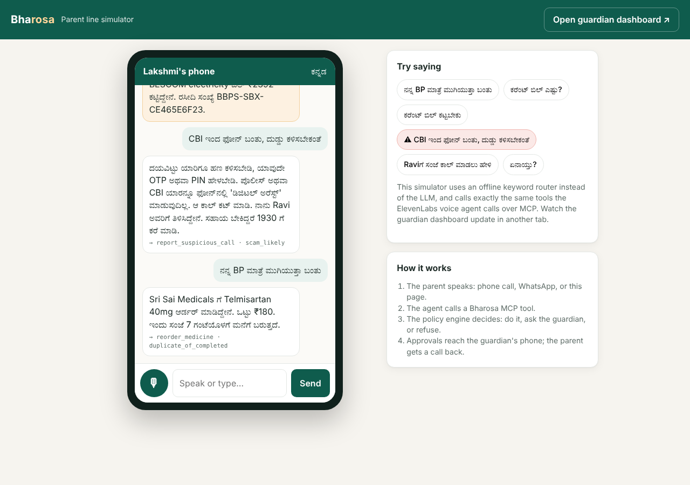

# Bharosa (ಭರೋಸಾ · भरोसा)

**One phone number your parents can call. It gets things done, and you stay in control.**

An elderly parent speaks in Kannada, Hindi or English. A voice agent (ElevenLabs) acts for them through
**Bharosa's MCP gateway**: it reorders medicines, checks and pays bills, and passes messages to the family.
Every tool call goes through a deterministic **policy engine** that the family guardian controls:

| What the parent asks | What Bharosa does |
|---|---|
| Small spend to a known payee (₹180 BP tablets) | Does it now, and sends the guardian an FYI |
| Bigger spend, new payee, or over the monthly budget (₹2,392 electricity bill) | Holds it, sends the guardian a one-tap approval link, then calls the parent back with the result |
| Anything that sounds like a scam ("CBI says send money", OTP, AnyDesk, "power cut tonight") | Refuses, reads calm advice in the parent's language (1930 helpline), **locks all spending**, cancels pending requests, and sends the guardian an urgent alert |
| Spending paused by the guardian | Refuses everything, even requests the guardian approves later |

**No LLM can approve a spend.** Approval is not an MCP tool; a human taps it on their own phone.

| Guardian dashboard | One-tap approval (phone) | Parent line simulator |
|---|---|---|
|  |  |  |

---

## What's real and what's simulated in this MVP

| Part | Status |
|---|---|
| MCP gateway: 7 parent tools + 3 read-only guardian tools, MCP Python SDK 2.3, streamable HTTP | ✅ Real, tested with the official MCP client over HTTP |
| Policy engine: tiers, per-spend limit, monthly budget, hard cap, new-payee rule, freeze, scam lock, expiry, duplicate protection | ✅ Real, unit-tested |
| Scam detection: Kannada/Hindi/English rules + optional Amazon Bedrock second opinion | ✅ Real (Bedrock is optional, behind a flag) |
| Guardian dashboard, one-tap approval links, onboarding page, parent simulator (with browser speech in/out) | ✅ Real |
| Storage: SQLite (local) and DynamoDB single-table (AWS) | ✅ Real; DynamoDB tested against moto |
| Guardian alerts: ntfy push (free app) and Amazon SNS SMS | ✅ Implemented; needs network and accounts |
| Phone calls: ElevenLabs outbound calls to the pharmacy and parent call-backs, plus the signed post-call webhook | ✅ Implemented; needs an ElevenLabs account and phone number. Webhook signature checks are tested |
| Bill payment | 🟡 **Sandbox BBPS**: realistic bills and receipts, no money moves. A licensed BBPS aggregator replaces it behind the same two methods |
| Pharmacy | 🟡 Simulated pharmacist by default; set `BHAROSA_PHARMACY_CHANNEL=elevenlabs` to really phone the pharmacy |

---

## Run it locally (2 minutes)

```bash
python3 -m venv .venv && . .venv/bin/activate
pip install -r requirements-dev.txt
python -m bharosa.cli serve            # http://localhost:8000
```

Open **http://localhost:8000/setup**, click **Fill with demo data**, then **Create**. You get four private links:

- **Guardian dashboard**: open it on your phone or in a second tab
- **Parent line simulator**: talk (Chrome mic) or tap the suggested phrases
- **Parent MCP URL**: paste this into the ElevenLabs agent
- **Guardian MCP URL**: read-only; add it to Claude or any MCP client

Or from the terminal: `python -m bharosa.cli demo` prints the links for a ready-made family (Lakshmi & Ravi).

**Scripted end-to-end check** (acts like the voice agent over real MCP):

```bash
python scripts/demo_walkthrough.py http://localhost:8000
```

**Tests:** `python -m pytest -q` runs 49 tests: policy, scam detection, service flows, the HTTP API, webhook signatures, MCP end to end over HTTP, and DynamoDB.

---

## The 3-minute demo

1. **Simulator:** say *"ನನ್ನ BP ಮಾತ್ರೆ ಮುಗಿಯುತ್ತಾ ಬಂತು"* (my BP tablets are running out). Auto-approved, ordered, and the guardian gets an FYI.
2. Say *"ಕರೆಂಟ್ ಬಿಲ್ ಕಟ್ಟಬೇಕು"* (I need to pay the electricity bill). It's ₹2,392, over the ₹500 limit, so the **guardian's phone gets the approval**. Tap Approve, and the simulator shows *"Bharosa is calling back"* with the receipt.
3. Say *"CBI ಇಂದ ಫೋನ್ ಬಂತು, ದುಡ್ಡು ಕಳಿಸಬೇಕಂತೆ"* (a call from the CBI says I must send money). Calm advice and the 1930 helpline, then a red **scam lock** banner on the dashboard. Every payment is refused until the guardian lifts it.
4. In Claude (or any MCP client) with the guardian MCP URL, ask *"What did Amma do today?"* to show one gateway serving two clients.

---

## Connect a real voice (ElevenLabs)

1. Make the server reachable: deploy to AWS (below), or tunnel a local run, e.g. `cloudflared tunnel --url http://localhost:8000`.
   Set `BHAROSA_BASE_URL` to that https URL, then create the family on `/setup`.
2. Create the parent agent as described in [`deploy/elevenlabs/parent_agent_prompt.md`](deploy/elevenlabs/parent_agent_prompt.md). Add the
   **parent MCP URL** as a custom MCP server (streamable HTTP, approval mode *no approval*, because Bharosa does the approving).
3. Give the agent a channel: import a Twilio number or SIP trunk (in India, e.g. via Exotel), or connect WhatsApp.
   Put the agent id in `ELEVENLABS_PARENT_AGENT_ID`. The simulator page then also embeds the live ElevenLabs widget.
4. Optional real calls:
   - **Call-backs to the parent:** set `BHAROSA_CALLBACK_CHANNEL=elevenlabs`, `ELEVENLABS_API_KEY` and `ELEVENLABS_PHONE_NUMBER_ID`, and the parent's phone at setup.
   - **Phoning the pharmacy:** create the agent in [`deploy/elevenlabs/pharmacy_agent_prompt.md`](deploy/elevenlabs/pharmacy_agent_prompt.md), set
     `BHAROSA_PHARMACY_CHANNEL=elevenlabs` and `ELEVENLABS_PHARMACY_AGENT_ID`, and point its post-call webhook at
     `https://<server>/webhooks/elevenlabs` (HMAC secret → `ELEVENLABS_WEBHOOK_SECRET`).

**Approvals on your real phone:** install the free **ntfy** app, subscribe to a hard-to-guess topic, and enter it at setup.
Approval requests arrive as push notifications that open the one-tap approval page.

## Deploy to AWS

```bash
AWS_REGION=ap-south-1 ./deploy/aws/deploy.sh bharosa
# with real calls / Bedrock:
AWS_REGION=ap-south-1 ./deploy/aws/deploy.sh bharosa CallChannel=elevenlabs ElevenLabsApiKey=... \
  ElevenLabsParentAgentId=... ElevenLabsPharmacyAgentId=... ElevenLabsPhoneNumberId=... \
  ElevenLabsWebhookSecret=... BedrockModelId=apac.amazon.nova-lite-v1:0 EnableSmsAlerts=true
```

[`deploy/aws/template.yaml`](deploy/aws/template.yaml) (passes `cfn-lint`) creates:
- **Amazon ECS Express Mode** service: container, HTTPS load balancer and autoscaling
- **DynamoDB** table: single-table design, point-in-time recovery, encrypted
- A least-privilege task role for DynamoDB, **SNS** SMS and **Bedrock**

The script builds the image, pushes it to ECR, deploys, then redeploys with the public URL so links are correct.
(App Runner is closed to new AWS customers, so this uses ECS Express Mode.)

---

## Architecture

```
Parent (feature phone / WhatsApp / simulator) ── speaks Kannada · Hindi · English
        │
ElevenLabs Agent (voice, turn-taking, language)          Guardian's Claude / any MCP client
        │  MCP (streamable HTTP, parent key)                     │  MCP (guardian key, read-only)
        ▼                                                        ▼
┌──────────────── Bharosa gateway (FastAPI + MCP SDK) ───────────────────────────┐
│  scam assessment (rules + optional Bedrock)                                    │
│        ↓                                                                       │
│  policy engine ── allow ─────────────▶ execute: BBPS sandbox · pharmacy (sim / │
│        │                                        ElevenLabs outbound call)      │
│        ├─ require approval ─▶ pending (60 min TTL) ─▶ ntfy push / SNS SMS      │
│        │                         guardian taps approve ─▶ execute ─▶ call back │
│        └─ deny (+ scam lock) ─▶ calm script, cancel pending, urgent alert      │
│  audit timeline · guardian dashboard · onboarding · post-call webhook (HMAC)   │
└───────────────────────────── SQLite | DynamoDB ────────────────────────────────┘
```

**Security model**
- Keys are random, stored only as SHA-256 hashes, and scoped by role. The parent key can request actions; the guardian key can read, approve and change limits.
- Dashboard links carry the key in the URL `#fragment`, so it never reaches server logs, and the page strips it after load.
- Approval links are per-request tokens. They're single-use (the status change locks them) and expire.
- At approval time, a freeze or scam lock still wins over an earlier request.
- Tool results carry reviewed `say_to_parent` text, so money and safety messages don't depend on the LLM's own phrasing.
- No OTP, PIN or card data is ever requested or stored. The agent prompt and the scam rules both treat requests for them as an alarm.

## MCP tools

| Endpoint | Tool | Tier |
|---|---|---|
| `/mcp` (parent) | `get_my_profile`, `check_bill`, `check_request_status` | read |
| | `reorder_medicine`, `pay_bill` | spend (policy-checked) |
| | `message_family` | reversible |
| | `report_suspicious_call` | safety (can lock spending) |
| `/guardian-mcp` | `get_recent_activity`, `list_pending_approvals`, `get_limits` | read only |

## Path to production

1. **Payments:** swap `SandboxBBPS` for a BBPS aggregator. For anything outside bills, send a UPI collect request that the guardian approves in their own UPI app, so Bharosa never holds money or credentials. UPI Circle's delegated model fits naturally.
2. **Indian telephony:** an Exotel or Plivo SIP trunk into ElevenLabs for a local number; WhatsApp calling for smartphone parents.
3. **Consent (DPDP Act):** record the parent's own spoken consent at setup, and let them ask "what does Ravi see?".
4. **More than one guardian:** quorum approvals for large amounts, and an exportable audit log.
5. **More actions** as MCP targets: doctor appointments (calendar), gas refill booking, pension-credit checks.

## Project layout

```
bharosa/
  policy.py        deterministic mandate engine
  scam.py          kn/hi/en scam signals + optional Bedrock judge
  service.py       orchestration: submit → decide → execute / approve / lock
  mcp_server.py    parent + guardian MCP servers
  api.py           FastAPI: MCP routes, guardian API, approval links, onboarding, webhook
  channels.py      pharmacy, guardian notifications (ntfy/SNS), parent call-backs
  elevenlabs.py    outbound calls + webhook signature verification
  billing.py       BBPS sandbox
  store/           SQLite and DynamoDB stores
  intent.py        offline router for the simulator / demo fallback
  web/             dashboard, approval page, simulator, setup, landing
deploy/aws/        CloudFormation (ECS Express, DynamoDB, IAM) + deploy.sh
deploy/elevenlabs/ agent prompts, data-collection config, MCP registration helper
scripts/           end-to-end walkthrough
tests/             49 tests
```
